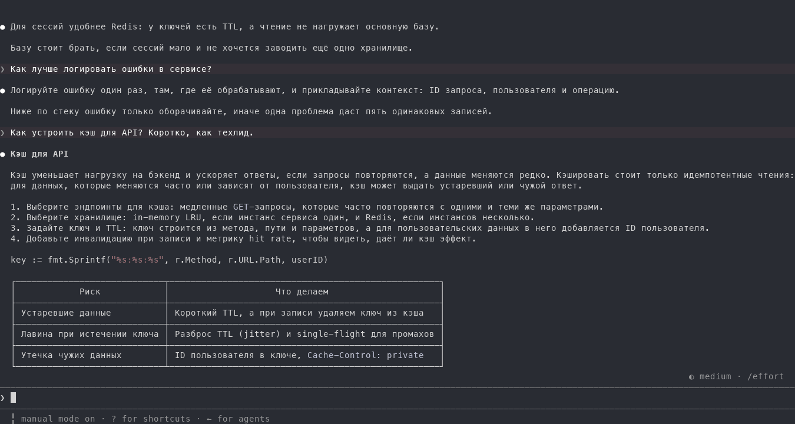
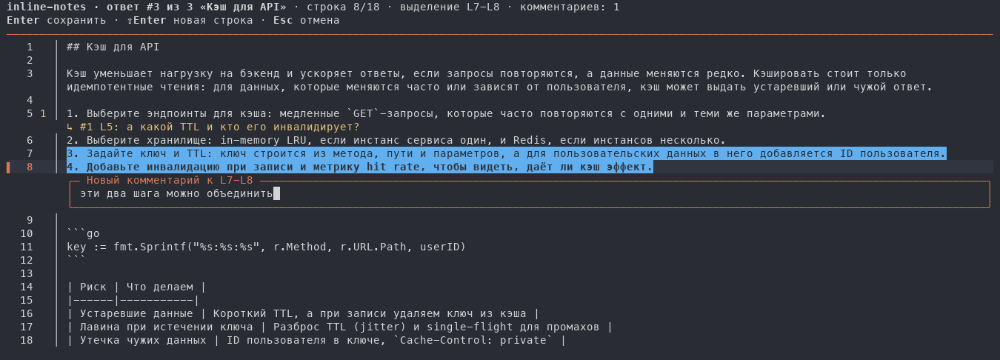
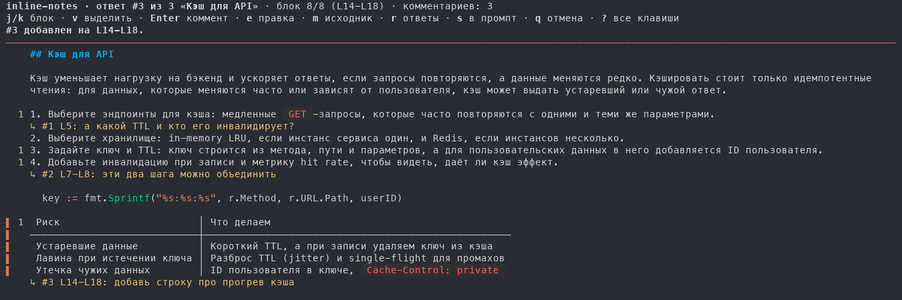
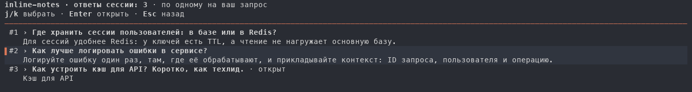
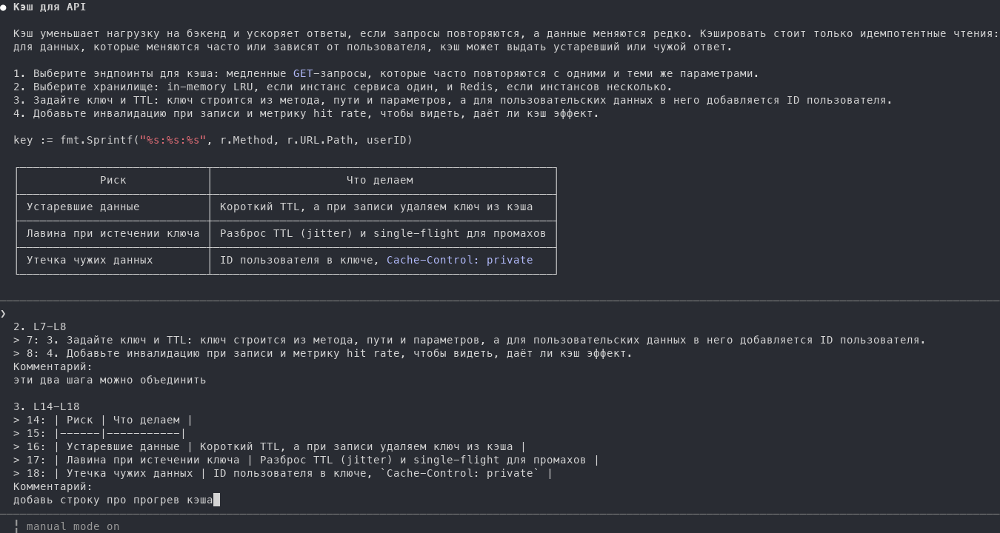

<div align="center">

# inline-notes-tui

**Review Claude Code and Codex CLI replies line by line, the way you review a pull request.**

Press `Ctrl+G` after a reply. It opens on the whole terminal, you leave comments on lines, ranges and blocks,<br>
and one keypress puts every comment back in the prompt box as a single prompt.

[](go.mod)
[](https://github.com/DaniilMats/inline-notes-tui/tags)
[](LICENSE)

**English** · [Русский](README.ru.md)



</div>

## Why

A long answer from Claude rarely needs one reply. It needs ten small ones: *this step is wrong*, *what TTL?*, *merge these two*. Typing them into the prompt means quoting lines by hand and losing track of what you already said. `inline-notes-tui` lets you point at the line itself, the way code review tools do, and hands Claude a tidy, numbered list where every comment carries the lines it is about.

## Features

- **Block, line and range comments.** A reply opens as rendered Markdown, where a comment takes a whole paragraph, table or code block. `m` switches to the numbered source lines: comment on any line there, or select a range with `v` first.
- **Any reply, not just the last.** `r` lists the session's replies, one per prompt you sent: what you asked and how the reply begins. Pick one with the arrows or the mouse.
- **One prompt back.** `s` builds one prompt that quotes the numbered lines of every comment and puts it after whatever you had already typed in the prompt box. It is not sent: read it, add a screenshot if you like, press Enter.
- **A real text field.** Comments are typed in a proper field: the arrows, `⇧Enter` for a new line, paste and dictation work as in any editor.
- **Exact layout.** Everything on screen is drawn by the program, so a click lands on the line or block you clicked, and the rendered view is Markdown rendered with [glamour](https://github.com/charmbracelet/glamour).
- **Keyboard first, mouse too.** `j`/`k` and the arrows move, `Enter` comments, a click on the cursor's line opens a comment, a click on a comment edits it. Keys also work on the Russian (ЙЦУКЕН) layout.
- **Your editor is still there.** `ctrl+e` opens the prompt, comments included, in your usual editor. Any file Claude Code did not hand over (a `git commit` message, say) goes straight to that editor.

| Source view | Rendered view |
| --- | --- |
|  |  |

| The session's replies (`r`) | The prompt, back in Claude Code |
| --- | --- |
|  |  |

> [!NOTE]
> The interface and the prompt it builds are in Russian unless you [switch them to English](#language); Claude usually answers in the prompt's language.

## Install

```sh
go install github.com/DaniilMats/inline-notes-tui@latest
```

It needs Go 1.26 or newer; an older `go` downloads that toolchain on its own. Then make it Claude Code's prompt editor in `~/.claude/settings.json`, with the full path to the binary:

```json
{
  "env": { "VISUAL": "/Users/you/go/bin/inline-notes-tui" }
}
```

`go env GOPATH` prints the folder; the binary is in its `bin`. The variable applies inside Claude Code only, your shell keeps its editor. Start a new Claude Code session to pick it up.

### Codex CLI

Start Codex with the same binary as its prompt editor:

```sh
VISUAL="$(go env GOPATH)/bin/inline-notes-tui" codex
```

For all new terminal sessions, add `export VISUAL="$HOME/go/bin/inline-notes-tui"` to your shell config (adjust the path if your GOPATH differs). Ordinary files still open in `$EDITOR`.

After a reply, press `Ctrl+G`. When Codex was launched with `codex resume <session-ID>`, that conversation opens directly on its last final reply; `r` lists its replies. The ID comes from the editor's parent process, not the newest transcript or an inherited `CODEX_THREAD_ID`.

Other launches show a session picker: filter by name, project directory or ID, then use the arrows and Enter to select. Esc cancels; Ctrl+E edits the draft normally. Codex does not pass the live session ID to external editors. If you switch conversations with `/new` or `/resume` inside a running Codex, the launch ID stays unchanged: restart with `codex resume <new-session-ID>` before using Ctrl+G.

Reads local rollouts under `${CODEX_HOME:-~/.codex}/sessions` and `archived_sessions`, including both legacy events and paginated-history events. Names come from `session_index.jsonl`. Remote-only histories are not available locally. The editor-file integration is verified with Codex CLI 0.166.0; older versions with different temporary-file paths can use `-transcript /path/to/rollout.jsonl` manually.

### Language

The interface and the prompt are in Russian unless `INLINE_NOTES_LANG` is `en`, which switches both to English. Set it beside `VISUAL`:

```json
{
  "env": {
    "VISUAL": "/Users/you/go/bin/inline-notes-tui",
    "INLINE_NOTES_LANG": "en"
  }
}
```

Any other value keeps Russian, and the review's header says so. The keys work on the Russian layout in either language.

## Usage

After Claude replies, press `Ctrl+G`. The last reply opens as rendered Markdown; `m` shows its numbered source lines.

| Key | Action |
| --- | --- |
| `j` / `k`, `↓` / `↑` | Next / previous line (a block in rendered view) |
| `g` / `G` | Top / bottom |
| `ctrl+d` / `ctrl+u`, `PgDn` / `PgUp` | Page down / up |
| `v` | Start or clear a range selection |
| `Enter`, a click on the cursor's line | Comment on the line or range |
| `e`, a click on a comment | Edit the comment; `d` deletes it |
| `n` / `N` | Next / previous comment |
| `m` | Switch between source and rendered Markdown |
| `r` | The session's replies: pick one, `Enter` or a click opens it |
| `[` / `]` | Previous / next reply |
| `s` | Put the comments in the prompt box and return to the agent |
| `ctrl+e` | Open the prompt, comments included, in your usual editor |
| `q` | Leave without changes (press twice if there are comments) |
| `?` | All keys |

In a comment, `Enter` saves it, `⇧Enter` (or `alt+Enter`, `ctrl+j`) starts a new line and `Esc` drops it. Another reply opens only while the current one has no comments: comments belong to their reply.

## Your usual editor

`ctrl+e`, a session with no replies yet, and any file that is not a Claude Code or Codex prompt all go to a plain editor: `$FB_EDITOR`, else `$EDITOR`, else `vi`. Its exit code is the program's.

## How it works

- **Entry point.** `Ctrl+G` in Claude Code runs `$VISUAL` on a temporary file holding your draft and hands it the terminal. When the editor exits with code 0, the file's text becomes the prompt box's. `s` appends the prompt to that file; `q` leaves it alone.
- **Where the reply comes from.** The parent process is the session's `claude`, which registers itself in `~/.claude/sessions/<pid>.json`. That names the session, whose transcript is `~/.claude/projects/<cwd>/<session>.jsonl`. Without a registry entry, the newest transcript of the working directory is used. Both are Claude Code's internal files, so a Claude Code update can change them.
- **What a reply is.** One per prompt you sent: the last text Claude wrote before your next message. The short notes it writes between tool calls are left out. `#N` counts your prompts from the start of the transcript.

## Limitations

- The CLI waits while the review is open, so review a reply once the agent has finished it. `s` returns a draft; it never sends it.
- The Claude desktop app has no terminal for the program to open in, so `Ctrl+G` there will most likely not work (untested).

For a review pane beside the conversation, which also works in the desktop app, see the [inline-notes](https://github.com/DaniilMats/inline-notes) plugin.

## Development

```sh
git clone https://github.com/DaniilMats/inline-notes-tui
cd inline-notes-tui
go test ./...
go run . -transcript ~/.claude/projects/<cwd>/<session>.jsonl   # review a transcript; the prompt goes to stdout
```

The review logic is pure state transitions in [`review.go`](review.go), the screen is [`ui.go`](ui.go) (bubbletea), and [`transcript.go`](transcript.go) finds the session and its replies. The code says everything in Russian; [`i18n.go`](i18n.go) holds the English for each string, and a test fails when one is missing.

[`codex.go`](codex.go) reads Codex's local sessions and user/assistant UI events, excluding reasoning, tool output and duplicate model-history records. [`codex_picker.go`](codex_picker.go) selects the conversation. These local file formats are internal to Codex and may change between versions.

## License

[MIT](LICENSE) © Daniil Matsyutsya
