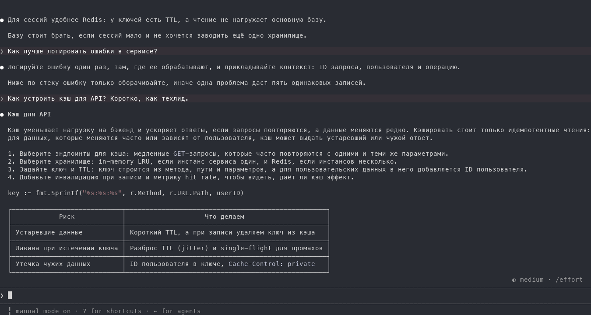
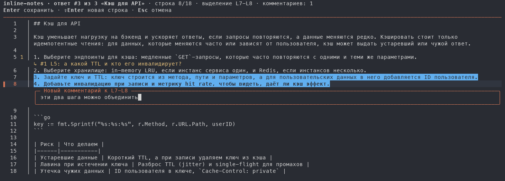
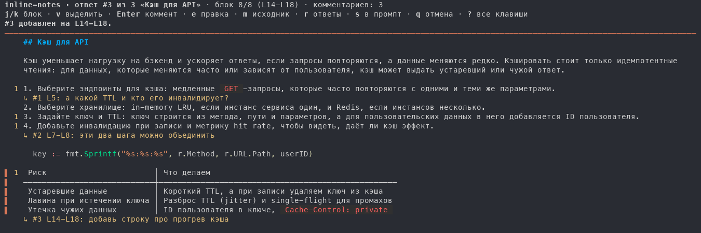
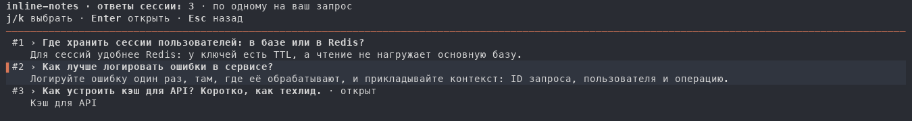
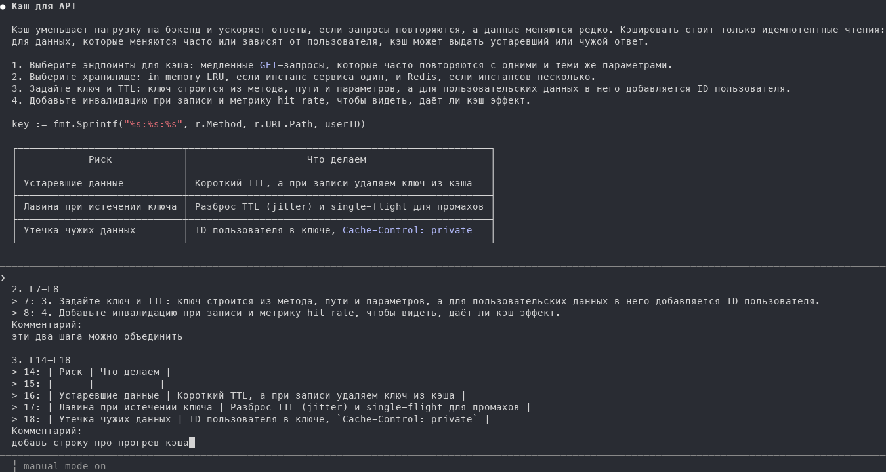

<div align="center">

# inline-notes-tui

**Ревью ответов Claude Code по строкам — как ревью пулреквеста.**

Нажмите `Ctrl+G` после ответа. Он откроется на весь терминал, вы оставите комментарии к строкам, диапазонам и блокам,<br>
а одна клавиша вернёт все комментарии в поле ввода Claude Code одним промптом.

[](go.mod)
[](https://github.com/DaniilMats/inline-notes-tui/tags)
[](LICENSE)

[English](README.md) · **Русский**



</div>

## Зачем

На длинный ответ Claude редко хочется ответить одной фразой. Обычно набирается десяток мелких замечаний: «этот шаг лишний», «а какой TTL?», «объедини эти два». Если писать их в промпт, строки приходится цитировать руками, и легко забыть, что уже сказано. `inline-notes-tui` даёт указать прямо на строку, как в инструментах код-ревью, и передаёт Claude аккуратный нумерованный список, где у каждого комментария есть строки, к которым он относится.

## Возможности

- **Комментарии к строке, диапазону и блоку.** Комментарий можно оставить на любой строке, `v` сначала выделяет диапазон, а в отрисованном markdown (`m`) комментарий ставится на целый абзац, таблицу или блок кода.
- **Любой ответ, не только последний.** `r` показывает ответы сессии, по одному на каждый ваш запрос: что вы спросили и с чего начинается ответ. Нужный выбирается стрелками или мышью.
- **Один промпт обратно.** `s` собирает все комментарии с цитатами пронумерованных строк в один промпт и дописывает его после того, что уже было в поле ввода. Промпт не отправляется: проверьте его, при желании вставьте скриншот и нажмите Enter.
- **Настоящее поле ввода.** Комментарий набирается в обычном текстовом поле: работают стрелки, `⇧Enter` для новой строки, вставка и голосовой ввод.
- **Точная разметка.** Всё на экране рисует сама программа, поэтому клик попадает в ту строку или блок, по которым вы кликнули. Отрисованный вид делает [glamour](https://github.com/charmbracelet/glamour).
- **Клавиатура и мышь.** `j`/`k` и стрелки двигают курсор, `Enter` открывает комментарий, клик по строке с курсором тоже, а клик по комментарию открывает его на правку. Клавиши работают и в русской раскладке.
- **Обычный редактор остаётся.** `ctrl+e` открывает промпт вместе с комментариями в вашем привычном редакторе. Любой файл не от Claude Code (например, сообщение `git commit`) сразу уходит в этот редактор.

| Исходник | Рендер |
| --- | --- |
|  |  |

| Ответы сессии (`r`) | Промпт в Claude Code |
| --- | --- |
|  |  |

## Установка

```sh
go install github.com/DaniilMats/inline-notes-tui@latest
```

Нужен Go 1.26 или новее; более старый `go` сам скачает нужную версию. Затем укажите программу редактором промпта в `~/.claude/settings.json`, с полным путём к бинарю:

```json
{
  "env": { "VISUAL": "/Users/you/go/bin/inline-notes-tui" }
}
```

Папку покажет `go env GOPATH`, бинарь лежит в её `bin`. Переменная действует только внутри Claude Code, редактор вашего шелла не меняется. Откройте новую сессию Claude Code, чтобы она подхватилась.

## Как пользоваться

После ответа Claude нажмите `Ctrl+G`. Откроется последний ответ с номерами строк.

| Клавиша | Что делает |
| --- | --- |
| `j` / `k`, `↓` / `↑` | Следующая / предыдущая строка (в рендере — блок) |
| `g` / `G` | В начало / в конец |
| `ctrl+d` / `ctrl+u`, `PgDn` / `PgUp` | Страница вниз / вверх |
| `v` | Начать или снять выделение диапазона |
| `Enter`, клик по строке с курсором | Комментарий к строке или диапазону |
| `e`, клик по комментарию | Править комментарий; `d` удаляет |
| `n` / `N` | Следующий / предыдущий комментарий |
| `m` | Переключить исходник и отрисованный markdown |
| `r` | Ответы сессии: выбрать, `Enter` или клик открывают |
| `[` / `]` | Предыдущий / следующий ответ |
| `s` | Вернуть комментарии в поле ввода и выйти в Claude Code |
| `ctrl+e` | Открыть промпт вместе с комментариями в привычном редакторе |
| `q` | Выйти без изменений (с комментариями — двойным нажатием) |
| `?` | Все клавиши |

В комментарии `Enter` сохраняет, `⇧Enter` (или `alt+Enter`, `ctrl+j`) переносит строку, `Esc` отменяет. Другой ответ открывается, только пока у текущего нет комментариев: комментарии относятся к своему ответу.

## Привычный редактор

`ctrl+e`, сессия без ответов и любой файл, который не является промптом Claude Code, уходят обычному редактору: `$FB_EDITOR`, иначе `$EDITOR`, иначе `vi`. Код его завершения становится кодом программы.

## Как это устроено

- **Точка входа.** `Ctrl+G` в Claude Code запускает `$VISUAL` с временным файлом, где лежит ваш черновик, и отдаёт ему терминал. Когда редактор завершается с кодом 0, текст файла становится содержимым поля ввода. `s` дописывает промпт в этот файл, `q` его не трогает.
- **Откуда берётся ответ.** Родительский процесс — `claude` этой сессии, и он записывает себя в `~/.claude/sessions/<pid>.json`. Оттуда программа берёт сессию, а её транскрипт лежит в `~/.claude/projects/<cwd>/<session>.jsonl`. Если записи нет, берётся самый свежий транскрипт рабочей папки. Оба файла — внутренние файлы Claude Code, и обновление Claude Code может их изменить.
- **Что считается ответом.** Один ответ на каждый ваш запрос: последний текст, который Claude написал до вашего следующего сообщения. Короткие заметки между вызовами инструментов в ответы не попадают. `#N` — порядковый номер запроса с начала транскрипта.

## Ограничения

- Пока ревью открыто, Claude Code ждёт его завершения, так что ревьюйте ответ после того, как Claude его закончил.
- В десктопном приложении Claude терминальной программе негде открыться, так что `Ctrl+G` там, скорее всего, не сработает (не проверялось).

Если нужна панель рядом с диалогом, которая работает и в десктопном приложении, посмотрите плагин [inline-notes](https://github.com/DaniilMats/inline-notes).

## Разработка

```sh
git clone https://github.com/DaniilMats/inline-notes-tui
cd inline-notes-tui
go test ./...
go run . -transcript ~/.claude/projects/<cwd>/<session>.jsonl   # ревью транскрипта; промпт уйдёт в stdout
```

Логика ревью — чистые переходы состояний в [`review.go`](review.go), экран — [`ui.go`](ui.go) на bubbletea, а [`transcript.go`](transcript.go) находит сессию и её ответы.

## Лицензия

[MIT](LICENSE) © Daniil Matsyutsya
